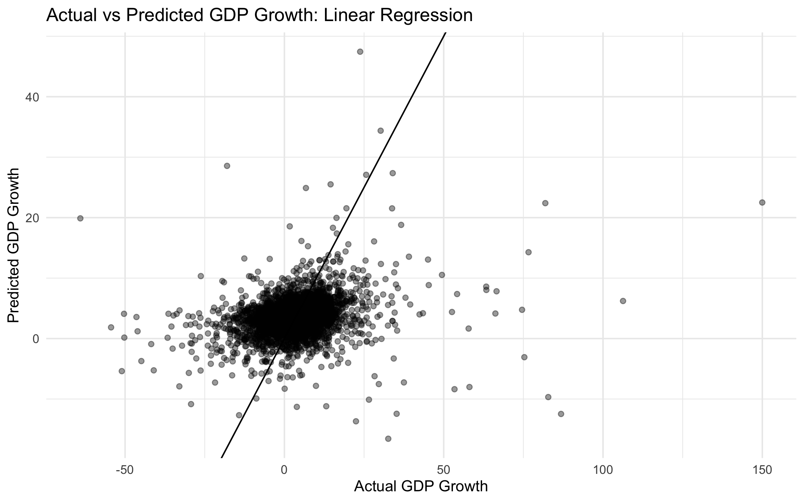
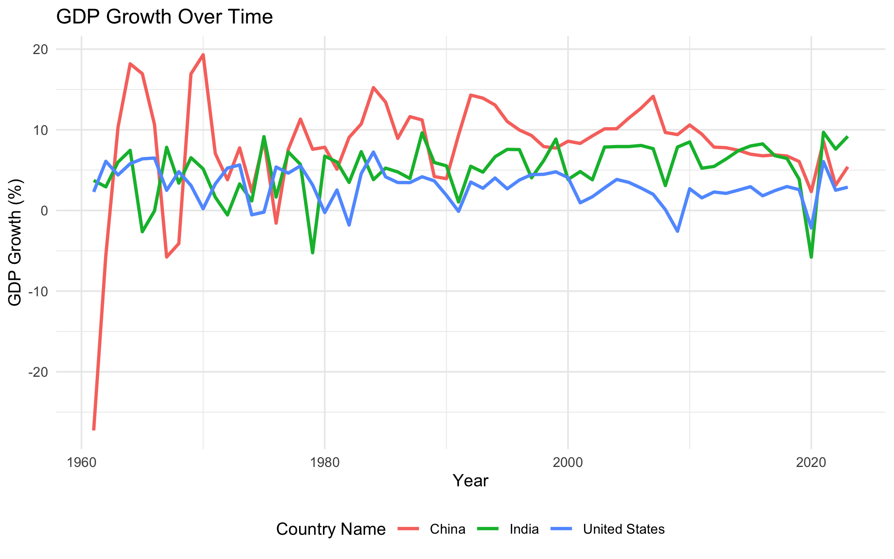

# Comparative Analysis of GDP Growth: Linear Regression vs. Decision Trees

**Course project · DATA 508 · MS in Data Science, Purdue University · Jaash Thakkar**

Can a country's GDP growth last year predict its growth this year? This project builds a country-year panel from World Bank data and compares a classic statistical model (linear regression) with a machine learning model (decision tree regression) on that question.

## Key findings

- Past GDP growth has a **weak positive relationship** with current growth: useful, but not a strong standalone predictor.
- The **decision tree** captures more structure by splitting the data into segments, but doesn't meaningfully improve accuracy and shows signs of overfitting.
- **Both models struggle with extreme values**, such as recessions and booms, showing the limits of single-variable economic forecasting.
- **Next steps:** add macroeconomic variables (inflation, unemployment, investment) and use cross-validation.

<!-- TODO: after running the script, add the R² and RMSE table it prints here -->



## Data

- **Source:** [World Bank World Development Indicators: GDP growth (annual %)](https://data.worldbank.org/indicator/NY.GDP.MKTP.KD.ZG), 1960–2023
- Reshaped from wide to long (one row per country-year), with a one-year lag of GDP growth engineered as the predictor
- The data isn't included in this repo. Download the CSV and save it in this folder as `gdp_growth.csv`.

## Approach

1. Cleaned and reshaped the panel with `tidyr` / `dplyr`, then created the lag feature by country
2. Fit a **linear regression** (`lm`) and a **decision tree** (`rpart`) of current growth on lagged growth
3. Compared models with **R²** and **RMSE**, plus actual-vs-predicted plots



## Run it

Install the packages once, then open `gdp_growth_analysis.R` in RStudio and run it top to bottom. It prints the R² and RMSE for both models.

```r
install.packages(c("readr", "dplyr", "tidyr", "ggplot2", "rpart"))
```

## Tools

R · tidyverse (dplyr, tidyr, ggplot2, readr) · rpart
